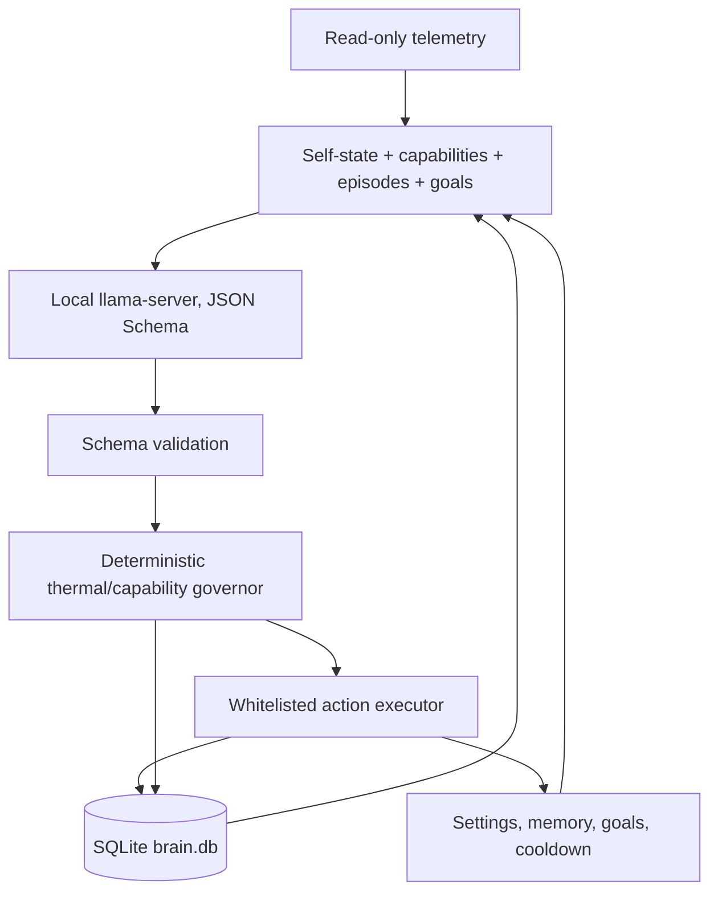

# Reflective Loop Runtime (RLR) v1a

RLR is a standalone, self-modeling agent loop for the Xavier NX. It does not
import AVA or the RLF Mamba project. The first version uses the local
Qwen2.5-1.5B llama-server for one constrained decision per tick and SQLite for
its self-model, episodic record, goals, and reflections.



## Safety and self-awareness

- The model can choose only `observe`, `set_vision_fps`, `set_reply_tokens`,
  `remember`, `recall`, `reflect`, `set_goal`, `complete_goal`, `cooldown`, or
  `abstain`. Invalid output is recorded and becomes `observe`.
- The action executor has no shell, network, power-mode, clock, thermal-guard,
  or arbitrary file-write operation. The only network client calls a
  loopback llama-server. Optional media retention copies into the RLR data
  directory and rejects copies above the configured byte budget.
- Measured Xavier throughput, RAM, power, efficiency, temperature, and the
  historical zero-RPM fan reading seed the capabilities table from
  `bench/RESULTS.md`. Missing/stale temperature or RAM evidence makes the loop
  abstain. The governor checks every proposal and records/feds vetoes back as
  episodes.
- At 70°C RLR caps vision at 2 FPS and replies at 64 tokens; at 75°C the caps
  become 1 FPS and 48 tokens. At 78°C it pauses decisions and heavy engines
  until every observed thermal zone falls below 70°C. Leave the Jetson in
  nvpmodel ID 5 (10W) with `thermal-guard` active; RLR never changes either.
- Each configured Nth tick, a second constrained prompt asks the model to
  report temperature, RAM, power mode, and active goal. RLR records numeric
  temperature/RAM error and exact mode/goal matches. A reflection is stored
  every M minutes (15 by default) or when the model selects `reflect`.

## Run

Start llama-server separately with the local Qwen2.5-1.5B model and its JSON
Schema response-format support enabled. RLR uses the OpenAI-compatible
`/v1/chat/completions` endpoint at `127.0.0.1:8080` by default.

```sh
cd jetsonXavier/rlr
python3 -m rlr --once
python3 -m rlr
```

The default database is `/models/rlr/brain.db`. For a development run:

```sh
python3 -m rlr --db ./data/brain.db --data-dir ./data --server http://127.0.0.1:8080 --tick 10
```

Configuration can also come from `RLR_DB`, `RLR_DATA_DIR`, `RLR_LLM_URL`,
`RLR_MODEL`, and `RLR_TICK_SECONDS`. The Python implementation uses the
standard library and SQLite; pytest is needed only for development checks.
To add input observations from an embedding application, call
`ReflectiveLoop.record_perception(...)`. Pass `retain_media=True` to copy
supplied frame/audio files under the data directory (2 GiB total by default).

## Tests

```sh
python3 -m pytest -q
```

The tests mock both the LLM and telemetry so the schema, governor, FTS memory,
thermal ladder, self-report scoring, and database migration can be checked on
a Mac without Jetson libraries or hardware.
